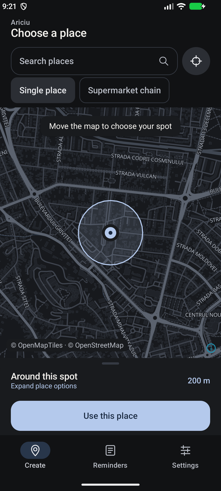
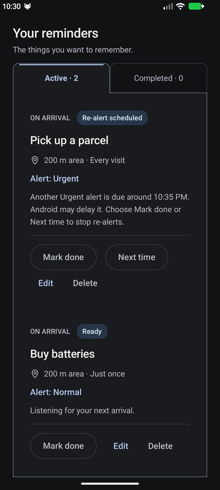
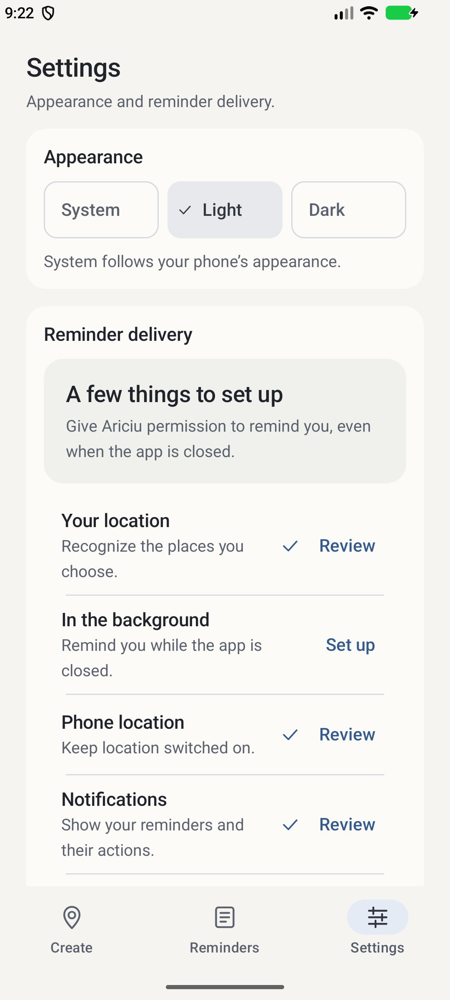

<p align="center">
  
</p>

<h1 align="center">Ariciu</h1>
<p align="center"><strong>Remember it when you get there.</strong><br>A location-based reminder app for Android.</p>

Most reminders ask *when*. Ariciu lets you choose *where*: pick up a parcel when you arrive nearby, or remember something before you leave. Your reminders live on your phone, with clear controls and no Ariciu account to create.

**Current build: 1.1-rc4 — early phone testing, not production-stable.**

<p align="center">
  
  
  
</p>
<p align="center"><sub>Real emulator captures with demonstration reminders. Create and Settings show the retained rc3 UI; Reminders shows rc4. Map © OpenStreetMap contributors · © OpenMapTiles, served by OpenFreeMap.</sub></p>

## What you can do

- **Remind by place:** arrive/ENTER or leave/EXIT a chosen radius, once or every visit.
- **Choose an alert:** Silent, Normal or Urgent. Swiping Urgent schedules another alert after approximately five minutes until you choose Done or Next time. Waiting status and actions are visible on the reminder card.
- **Find places locally:** search a bundled Romanian catalogue of 26,065 places, including towns, shops and malls. No remote search API. Selected supermarket chains have map previews and an accessible list.
- **Keep the map useful:** move the map, use My location, adjust the radius, and expand or collapse place options. Download up to three small, theme-specific map areas for limited offline viewing.
- **Make it comfortable:** System, Light and Dark appearance, restrained graphite/slate colours, scalable text, clear Active/Completed tabs and delivery setup guidance.
- **Test an arrival explicitly:** new single-place arrival reminders can optionally check “Notify me now if I’m already here.” A fresh, sufficiently accurate foreground fix is required; the option starts off.

## How it works

1. Choose a single place or a supermarket chain in **Create**. Search locally, move the map, or use My location.
2. Set the radius, arrival/departure rule, repeat behaviour and alert level, then save.
3. Follow **Settings → Reminder delivery** to enable the permissions and device services needed for monitoring.
4. Android reports a qualifying crossing; Ariciu records the occurrence and delivers the notification. Choose **Mark done** to complete it, or **Next time** to wait for another qualifying visit.

Saving and monitoring are separate: Settings and reminder cards show registration or notification-access problems. Chain reminders monitor the saved selection of nearby stores, rather than following you continuously.

## Install the phone-testing build

[Release notes: Ariciu 1.1-rc4](https://github.com/andreicosmin02/Ariciu/releases/tag/v1.1-rc4) · [Download the APK](https://github.com/andreicosmin02/Ariciu/releases/download/v1.1-rc4/Ariciu-1.1-rc4-debug.apk)

The repository is currently private; GitHub repository access is required to view/download the release. Requires **Android 8.0/API 26+**, a compatible map-rendering device and **Google Play services**. This minimum is a build requirement; not every supported Android version has been tested. Location services, appropriate location/background access and notification access are needed for delivery.

Open the downloaded APK and allow installation from that browser/file manager when Android prompts. **Update over the existing Ariciu debug build; do not uninstall or clear storage.** The package is `ro.andrei.ariciu`, version code **5**, with a tested additive Room migration to schema **5**. If installation reports a signature mismatch, stop and preserve your data.

This APK uses the existing **debug certificate**, not production signing. A developer’s own debug key may differ. Production signing and a safe update transition are future work; no Google Play release is implied.

APK SHA256:

```text
f6bfa834034599addd680768d39e1e86caac96c32a9cd79052723be1f5863d78
```

## Privacy, offline use and costs

Reminder records, lifecycle state, appearance preferences and catalogue search stay local. Ariciu has no mandatory account, backend, Firebase, analytics integration or cloud sync, and introduces no paid API or recurring charge.

Maps have a network boundary: browsing and explicit downloads request tiles, styles, sprites and fonts from **OpenFreeMap**, disclosing requested map areas and IP to the provider/CDN. Google Play services handles positioning/geofencing under Android’s permission controls; offline maps do not guarantee offline positioning. Public map hosting has availability and [terms limits](https://openfreemap.org/tos/).

## Practical limits

- Geofence detection and background work can be delayed by Android, Doze, battery restrictions and manufacturer policies. This is not a safety-critical or guaranteed-immediate alarm.
- Urgent notifications can be individually dismissed on modern Android. Re-alerts become eligible after about five minutes; notification permission, channel settings and DND still apply. No continuous sound, full-screen workaround or exact alarm is used.
- **Alarm is temporarily unavailable for new reminders.** Existing Alarm data, edits and actions remain supported; conversion to Urgent is explicit.
- The shared monitoring limit is **100 geofence areas**. New/refreshed chain selections include at most 40 catalogue stores within 25 km of the pin; coverage is incomplete and updates require an explicit refresh.
- Offline packs cover roughly **4×4 km**, zooms 10–14, for the selected theme. Other areas/detail levels can need internet. Download size/time limits apply.
- The Romanian catalogue is community data, not a complete address geocoder or official retailer directory. It can be outdated or incorrect.

## Built with

**Kotlin · Jetpack Compose · Material 3 · Room · WorkManager · Google Play Services Geofencing · MapLibre Compose/Native**

Single-activity Android architecture with local persistence, guarded reminder generations/occurrences, a notification outbox and recoverable geofence registration. [Delivery architecture](docs/DELIVERY_ARCHITECTURE.md) explains the reliability boundaries.

## Development

`master` is the authoritative baseline. Development currently focuses on physical-phone testing, bug fixes, accessibility and stabilization; initial owner feedback is positive, with further Samsung/background and older-runtime checks pending.

Open the project in Android Studio, install **Android SDK Platform 37** and the required build tools, and use the checked-in Gradle wrapper/version catalogue with the requested **JDK 25** Gradle daemon toolchain (Java source compatibility remains 11). Sync, then build:

```bash
./gradlew :app:assembleDebug
./gradlew :app:testDebugUnitTest :app:lintDebug
```

Run instrumentation only on a deliberately selected test emulator, preserving daily-use phone data:

```bash
ANDROID_SERIAL=emulator-5554 ./gradlew :app:connectedDebugAndroidTest
```

The rc4 gate passed **97 unit tests, 44 Android 17 emulator tests, lint with 0 errors/39 warnings, and debug assembly**. Signature, version and downloaded-release checksum were verified. Emulator tests do not certify physical GPS, OEM background timing or all Android versions.

Start with [project status](docs/PROJECT_STATUS.md), [contributor guidance](AGENTS.md), [documentation index](docs/README.md), [Urgent evidence](docs/URGENT_RE_ALERTS.md) and the [phone retest checklist](docs/PHONE_VERIFICATION.md).

## Credits and licences

- **OpenStreetMap contributors:** map data and the Romanian catalogue are attributed to OSM. The derived catalogue is distributed under **ODbL 1.0**, with the full [TSV](app/src/main/assets/places/romania.tsv), [provenance/notice](app/src/main/assets/places/NOTICE.md) and [reproducible generator](tools/build_place_catalog.py). The source extract is from Geofabrik.
- **OpenFreeMap and OpenMapTiles:** hosting, schema and style lineage; bundled [upstream notice](app/src/main/assets/map/LICENSE-openfreemap.md), [light-style licence](app/src/main/assets/map/LICENSE-light-style.md) and [dark-style licence](app/src/main/assets/map/LICENSE-dark-style.md) retain MIT/BSD, CC-BY and source-design attributions as applicable. These notices also credit Noto Sans, Maki and Natural Earth.
- **MapLibre Compose/Native:** [BSD-3-Clause](https://raw.githubusercontent.com/maplibre/maplibre-compose/v0.13.1/LICENSE)/[BSD-2-Clause](https://raw.githubusercontent.com/maplibre/maplibre-native/main/LICENSE.md) projects. Kotlin, AndroidX and OkHttp retain their respective licences; Google Play services is governed by its SDK terms.

There is currently **no project-wide Ariciu licence declaration**. Third-party licences do not establish a licence for Ariciu’s own source or assets. See the bundled notices for their full terms.
