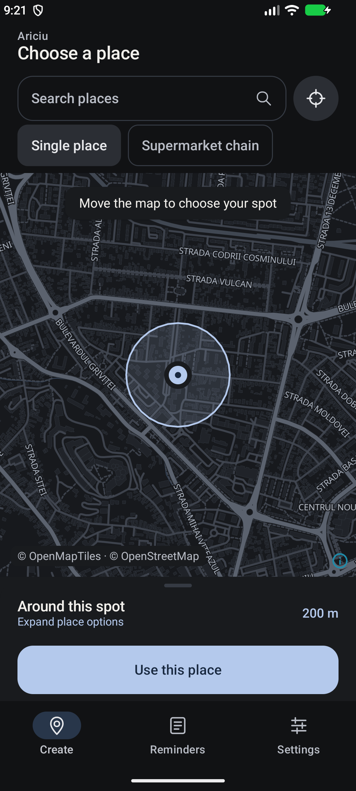
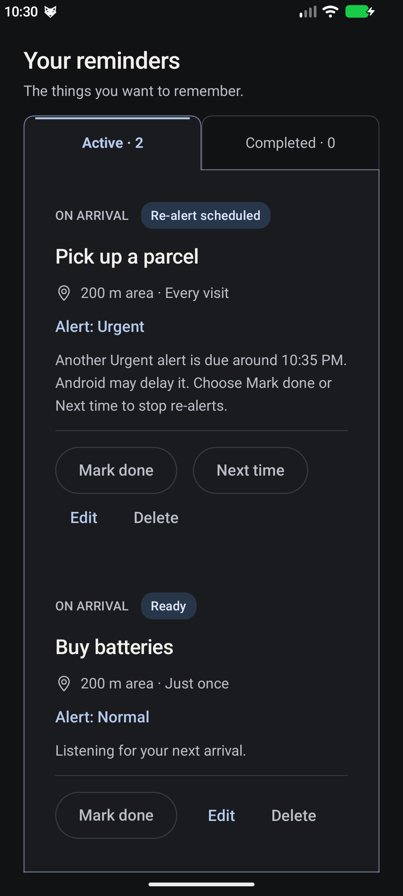
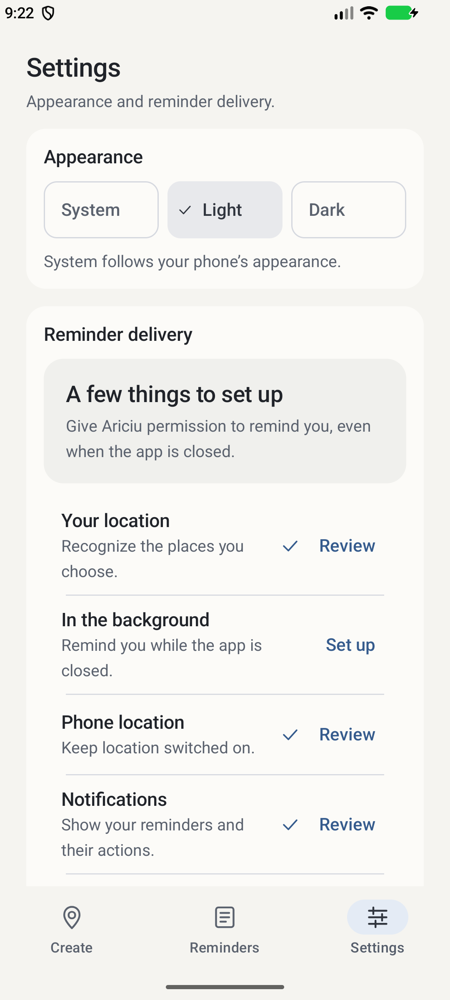

<p align="center">
  
</p>

<h1 align="center">Ariciu</h1>
<p align="center"><strong>Remember it when you get there.</strong><br>A location-based reminder app for Android.</p>

Most reminders ask *when*. Ariciu lets you choose *where*: pick up a parcel when you arrive nearby, or remember something before you leave. Your reminders live on your phone, with clear controls and no Ariciu account to create.

**Current build: 1.2-rc1 — early phone testing, not production-stable.**

<p align="center">
  
  
  
</p>
<p align="center"><sub>Real emulator captures with demonstration reminders. These screenshots predate 1.2-rc1: Create and Settings show the rc3 UI and Reminders shows rc4, so the newer map controls and Search data screens are not pictured. Map © OpenStreetMap contributors · © OpenMapTiles, served by OpenFreeMap.</sub></p>

## What you can do

- **Remind by place:** arrive/ENTER or leave/EXIT a custom geographical radius, Once or Every visit, with offline-first local reminder storage.
- **Choose an alert:** Silent, Normal or Urgent. Swiping Urgent schedules another alert after approximately five minutes until you choose Done or Next time. Waiting status and actions are visible on the reminder card.
- **Find places offline, across Europe:** search shops, pharmacies, fuel stations, banks, food, hospitals, post offices, hardware stores, bakeries, malls and towns. Romania is built in; for any of 49 other European countries, download its place list once in **Settings → Search data** (a few MB each, 89 MB for all of them) and update or remove it there. Searching never uses the internet and there is no remote search API. Results show on the map, and one reminder can cover many stores of a chain.
- **Keep the map useful:** move the map, use My location, adjust the radius, and expand or collapse place options. **Download area** saves the largest area around the visible map that fits the free map provider's limits (one theme, light or dark), with no limit on how many areas you keep. It checks free storage first, and offers a smaller area if a dense city centre stops at the limit.
- **Make it comfortable:** System, Light and Dark appearance, restrained graphite/slate colours, scalable text, clear Active/Completed tabs and delivery setup guidance.
- **Test an arrival explicitly:** new single-place arrival reminders can optionally check “Notify me now if I’m already here.” A fresh, sufficiently accurate foreground fix is required; the option starts off.

## How it works

1. Choose a single place or a supermarket chain in **Create**. Search locally, move the map, or use My location.
2. Set the radius, arrival/departure rule, repeat behaviour and alert level, then save.
3. Follow **Settings → Reminder delivery** to enable the permissions and device services needed for monitoring.
4. Android reports a qualifying crossing; Ariciu records the occurrence and delivers the notification. Choose **Mark done** to complete it, or **Next time** to wait for another qualifying visit.

Saving and monitoring are separate: Settings and reminder cards show registration or notification-access problems. Chain reminders monitor the saved selection of nearby stores, rather than following you continuously.

## Install the phone-testing build

[Release notes: Ariciu 1.2-rc1](https://github.com/andreicosmin02/Ariciu/releases/tag/v1.2-rc1) · [Download the APK](https://github.com/andreicosmin02/Ariciu/releases/download/v1.2-rc1/Ariciu-1.2-rc1-debug.apk) · [Search data files](https://github.com/andreicosmin02/Ariciu/releases/tag/places-data) · [Companion third-party notices](docs/third-party/README.md)

Download access follows repository visibility. Requires **Android 8.0/API 26+**, a compatible map-rendering device and **Google Play services**. This minimum is a build requirement; not every supported Android version has been tested. Location services, appropriate location/background access and notification access are needed for delivery.

Open the downloaded APK and allow installation from that browser/file manager when Android prompts. **Update over the existing Ariciu debug build; do not uninstall or clear storage.** The package is `ro.andrei.ariciu`, version code **6**, Room schema **5** (unchanged from 1.1-rc4). On an emulator, installing 1.2-rc1 over the published 1.1-rc4 APK succeeded and kept the reminder database; it has not been checked on a physical phone yet. If installation reports a signature mismatch, stop and preserve your data.

This APK uses the existing **debug certificate**, not production signing. A developer’s own debug key may differ. Production signing and a safe update transition are future work; no Google Play release is implied.

APK SHA256:

```text
fd3ed7ba834504484c06f935a134e8fc549b24e2a4b7709a1fa84120ef092e89
```

## Privacy, offline use and costs

Reminder records, lifecycle state, appearance preferences and place search stay local. Ariciu has no mandatory account, backend, Firebase, analytics integration or cloud sync, and introduces no paid API or recurring charge.

Maps have a network boundary: browsing and explicit downloads request tiles, styles, sprites and fonts from **OpenFreeMap**, disclosing requested map areas and IP to the provider/CDN. Google Play services handles positioning/geofencing under Android’s permission controls; offline maps do not guarantee offline positioning. Public map hosting has availability and [terms limits](https://openfreemap.org/tos/).

Search data has a second, smaller network boundary: only when you tap Load, Download or Update in **Settings → Search data**, the app fetches the country files from this repository's public `places-data` release on github.com, which can see your IP address and which files you request. Your location and searches are never sent. Backups are off, and only the launcher screen is exported.

## Practical limits

- Geofence detection and background work can be delayed by Android, Doze, battery restrictions and manufacturer policies. This is not a safety-critical or guaranteed-immediate alarm.
- Urgent notifications can be individually dismissed on modern Android. Re-alerts become eligible after about five minutes; notification permission, channel settings and DND still apply. No continuous sound, full-screen workaround or exact alarm is used.
- **Alarm is temporarily unavailable for new reminders.** Existing Alarm data, edits and actions remain supported; conversion to Urgent is explicit.
- The shared monitoring limit is **100 geofence areas**. New/refreshed chain selections include at most 40 catalogue stores within 25 km of the pin; coverage is incomplete and updates require an explicit refresh.
- Offline map areas cover only what fits one download (at most 3,000 tiles or 50 MB under the provider's terms; the app stops earlier, at 2,500 tiles or 45 MB), zooms 10–14, for the selected theme, plus about 18 MB of fonts and styling. Dense city centres give smaller areas. Other areas and detail levels need internet. Downloads are one at a time.
- Offline maps and search data are separate: a downloaded map area does not add searchable places, and a search pack does not download map tiles.
- The place lists are community OpenStreetMap data, not a complete address geocoder or official retailer directory. They can be outdated or incorrect, and an update is only as new as the last rebuild of the data release (no scheduled refresh). Russia is not included; Turkey, Ukraine, Belarus, Georgia, Moldova and Kosovo are.

## Built with

**Kotlin · Jetpack Compose · Material 3 · Room · WorkManager · Google Play Services Geofencing · MapLibre Compose/Native**

Single-activity Android architecture with local persistence, guarded reminder generations/occurrences, a notification outbox and recoverable geofence registration. [Delivery architecture](docs/DELIVERY_ARCHITECTURE.md) explains the reliability boundaries.

## Development

`master` is the authoritative baseline. Development currently focuses on physical-phone testing, bug fixes, accessibility and stabilization; initial owner feedback is positive, with further Samsung/background and older-runtime checks pending.

Follow [Build and test](docs/DEVELOPMENT.md) for cloning, local SDK configuration and Android Studio sync. Use **SDK Platform 37**, **Build Tools 36.0.0**, the checked-in **Gradle 9.5.0** wrapper and requested **JDK 25** daemon toolchain (Java source compatibility is 11). Then build:

```bash
./gradlew :app:assembleDebug
./gradlew :app:testDebugUnitTest :app:lintDebug
```

Run instrumentation only on a deliberately selected disposable test device. Replace the placeholder with its serial; disconnect daily-use devices first:

```bash
adb devices -l
export ARICIU_TEST_SERIAL="YOUR_TEST_DEVICE_SERIAL"
ANDROID_SERIAL="$ARICIU_TEST_SERIAL" ./gradlew :app:connectedDebugAndroidTest
```

For 1.2-rc1 the unit tests, the instrumented tests on an Android emulator and the debug assembly passed; lint was not re-run. The signing certificate matches 1.1-rc4 and the downloaded APK matched its published checksum. The last full rc4 gate was 97 unit tests, 44 emulator tests and lint with 0 errors/39 warnings. Emulator tests do not certify physical GPS, OEM background timing or all Android versions.

The Europe place lists are rebuilt with `tools/build_place_packs.py` (see [Search data packs](docs/SEARCH_DATA_PACKS.md)).

Start with [project status](docs/PROJECT_STATUS.md), [contributor guide](CONTRIBUTING.md), [documentation index](docs/README.md), [Urgent evidence](docs/URGENT_RE_ALERTS.md) and the [phone retest checklist](docs/PHONE_VERIFICATION.md).

## Licence

Ariciu-owned source code and original project material are distributed under **[Apache License 2.0](LICENSE)**, where the owner has the necessary rights. See [NOTICE](NOTICE) and the [licence scope](docs/LICENSING.md).

Third-party code/assets retain their own licences. The OSM-derived place catalogues (the built-in Romanian one and the downloadable European packs) remain **ODbL 1.0**; map styles and depicted map content retain their BSD/Creative Commons/data terms. Apache-2.0 does not relicense these materials.

The existing **v1.1-rc4 tag and debug APK predate these licence files** and remain unchanged. Read the [companion distribution notices](docs/third-party/README.md) when downloading or redistributing the testing APK; they are supplied separately, not inserted into that historical binary.

## Credits and licences

- **OpenStreetMap contributors:** map data and the place catalogues are attributed to OSM. The derived catalogues are distributed under **ODbL 1.0**: the built-in Romania data in [app/src/main/assets/places](app/src/main/assets/places/NOTICE.md) and the European packs as files of the [places-data release](https://github.com/andreicosmin02/Ariciu/releases/tag/places-data), with the [reproducible generators](tools/build_place_catalog.py) ([pack builder](tools/build_place_packs.py)). The source extracts are from Geofabrik.
- **OpenFreeMap and OpenMapTiles:** hosting, schema and style lineage; bundled [upstream notice](app/src/main/assets/map/LICENSE-openfreemap.md), [light-style licence](app/src/main/assets/map/LICENSE-light-style.md) and [dark-style licence](app/src/main/assets/map/LICENSE-dark-style.md) retain MIT/BSD, CC-BY and source-design attributions as applicable. These notices also credit Noto Sans, Maki and Natural Earth.
- **MapLibre Compose/Native:** [BSD-3-Clause](https://raw.githubusercontent.com/maplibre/maplibre-compose/v0.13.1/LICENSE)/[BSD-2-Clause](https://raw.githubusercontent.com/maplibre/maplibre-native/main/LICENSE.md) projects. Kotlin, AndroidX and OkHttp retain their respective licences; Google Play services is governed by its SDK terms.

Existing upstream notices and attribution remain intact. Proper Alarm support, a complete production binary notice inventory and production signing are future work, not capabilities or certification promised by this testing build.
