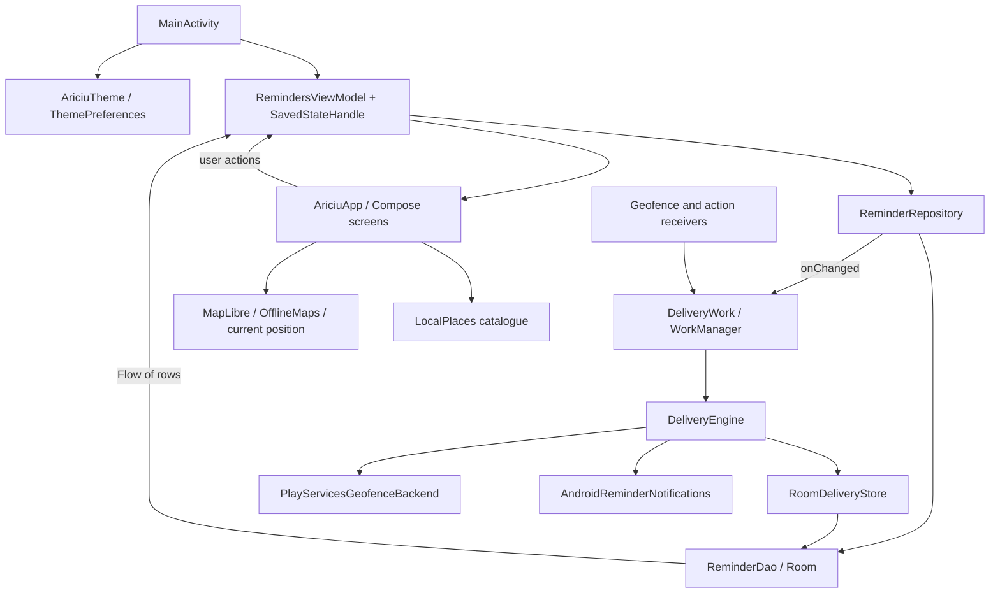

# Architecture

## Current rc4 update

Room 5 adds two retry fields with an additive migration; application-owned Urgent lifecycle/delayed one-time work remains in the established engine/outbox architecture. No new dependency, permission or backend. See [[Ariciu - Urgent Re-alerts]].

Related: [[Ariciu - Code Map]], [[Ariciu - Data and Migrations]], [[Ariciu - Background Work and Recovery]].

## Shape of the application

One Gradle application module, `:app`; package/application ID `ro.andrei.ariciu`. Kotlin, Compose and Material 3, one `MainActivity`, no backend and no Hilt/service locator framework. Feature packages are organizational boundaries, not separate Gradle modules.

Application-owned models, lifecycle, geometry, allocation, search ranking and download-budget logic avoid Android/Compose/MapLibre where practical. Android adapters own permissions, Room, notifications, Play services and native map downloading. UI components also directly own some platform work; the ViewModel is not the owner of every screen operation.

## Wiring and ownership

`MainActivity.onCreate` creates notification channels, requests forced reconciliation, collects theme preference and constructs the activity ViewModel with a factory and `createSavedStateHandle`. The repository's `onChanged` callback schedules reconciliation after successful local save/delete. Notification intent extras are consumed on creation/new intent; a sequence key makes repeated opens observable.

`RemindersViewModel` owns asynchronous repository observation, busy/errors, draft/edit/save identity and route state. `viewModelScope` owns its jobs. `AriciuApp` collects state with lifecycle awareness and handles discard/delete dialogs and tab routing. `rememberSaveableStateHolder` protects map state keyed by draft location.

`ThemePreferences` is SharedPreferences plus StateFlow. `LocalPlaces` caches a bundled catalogue after IO loading. `OfflineMaps` is a process singleton around MapLibre Native's database; UI/lifecycle hooks pause downloads. The picker owns its one-shot positioning coroutine. These have different persistence and cancellation boundaries.

## Invariants to protect

- Room is the source of reminder truth; saving is not registering or delivering.
- Repository edits get a new generation. Engine writes are conditioned on ID **and** generation.
- Occurrence tokens distinguish newer alerts; stale notification actions cannot mutate a newer occurrence.
- Journal desired platform IDs before adding; retain obsolete IDs until removal succeeds.
- Persist notification outbox state before posting, clear only after success.
- Workers share one process mutex; lifecycle mutations also use Room transactions. UI edits can still overlap platform calls.
- At most 100 actual monitored areas; chains consume multiple slots.
- Room, WorkManager and Android services are separate commits. Recovery is best-effort; no absolute exactly-once guarantee.

Do not move vendor types into domain models, replace the engine to fix a UI issue, or introduce a framework/dependency without demonstrated need. See [[Ariciu - Maintenance and Extension]].
