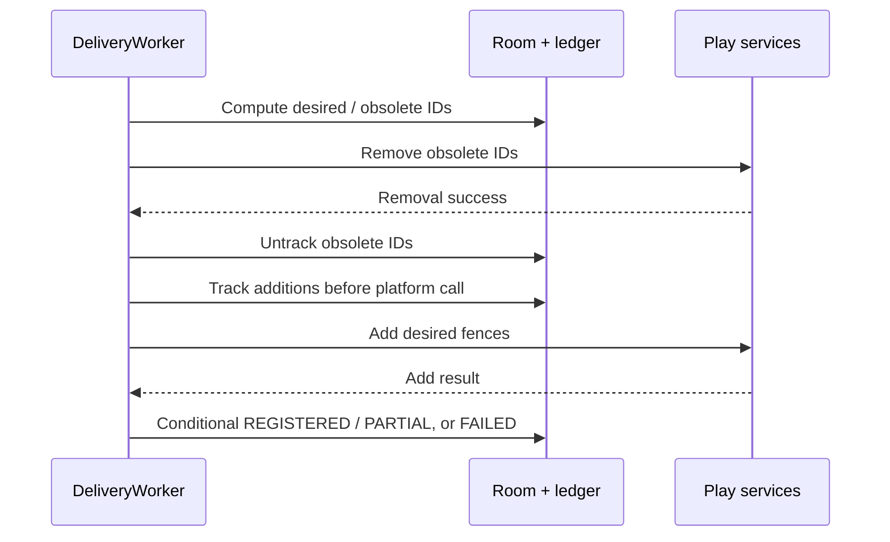

# Background commands, synchronization and recovery

Related: [[Ariciu - Architecture]], [[Ariciu - Notifications and Alarm]], [[Ariciu - Data and Migrations]].

Source: `feature/delivery/platform/DeliveryWork.kt`, with plain orchestration in `feature/delivery/model/DeliveryEngine.kt`.

## Persistent work queues

| Unique work | Policy and function |
| --- | --- |
| delivery-events | APPEND_OR_REPLACE; persisted transition/action/unavailable commands. |
| delivery-reconcile | APPEND_OR_REPLACE; registration synchronization, optional force and restoration. |
| snooze:requestId:occurrence | KEEP; a separate delayed one-time worker for a stored deadline. |

Separating event/action and registration chains prevents registration backoff from holding up Done/Next time. A process-wide coroutine Mutex serializes DeliveryWorker execution; lifecycle updates also use Room transactions. WorkManager durability does not make receiver enqueue and database commits atomic.

## Worker order

1. Construct RoomDeliveryStore, platform backend, notification adapter and DeliveryEngine.
2. Apply a valid crossing/action/unavailable command. Action time is current wall-clock time.
3. For a snooze worker that ran before remaining deadlines (for example after clock changes), retry instead of alerting early.
4. Wake all due stored snoozes and schedule outstanding deadlines by parent generation/occurrence.
5. Read current capabilities, cancel obsolete notifications and dispatch pending alerts. Boot restoration can repost unresolved previously delivered notifications quietly.
6. A reconcile command synchronizes geofences inside a 20-second timeout. Other commands enqueue reconciliation afterwards.

Transition/action work is designed to be idempotent and retryable. Registration retries are bounded: attempts 0–4, exponential backoff starting at 30 seconds, then success with a visible failure state so app/user/boot recovery can try again. Command exceptions are logged with tag AriciuDelivery. Cancellation propagates; it is not silently converted to success.

## Registration journal

If add succeeds but its result is lost, stable IDs make re-add safe. If removal fails, the old ledger IDs remain for retry. Generation-conditioned writes protect newer edits/deletes, but stale platform side effects can still exist until reconciliation runs again.

## Recovery triggers

Startup and UI resume, foreground device Location changes, return from setup, repository save/delete, actions/events, Play services error, BOOT_COMPLETED and MY_PACKAGE_REPLACED enqueue synchronization. Boot requests unresolved-notification restoration; package replacement requests force registration without that restore flag. There is no periodic location polling or geofencing foreground service.

Room outbox state, the registration ledger and snooze deadlines survive process death. SavedStateHandle can restore a draft after activity/process recreation, but is not a durable user backup. Force-stopped apps need reopening. WorkManager quotas, device restrictions and scheduling latency can prevent immediate recovery.

## Crash windows to understand

| Boundary | Existing repair mechanism / limit |
| --- | --- |
| Save → enqueue reconciliation | Startup/resume/boot reconciliation retries; not a shared transaction. |
| Receiver → enqueue command | goAsync waits for enqueue; unrecoverable enqueue errors are logged, not falsely delivered. |
| Ledger track → platform add | Stable IDs and future forced reconciliation. |
| Platform notification post → clear outbox | Same tag/token retry and OnlyAlertOnce when current alert exists. |
| Stop platform silence → persist Stop | Receiver first requests silence; worker persists quiet later. A crash window remains. |
| Snooze deadline → enqueue delayed work | Future workers/app/boot scan stored deadlines. |

No blanket exactly-once, immediate delivery or complete missed-event reconstruction claim is justified. See [[Ariciu - Risks and Technical Debt]] for audit hypotheses requiring reproduction.
