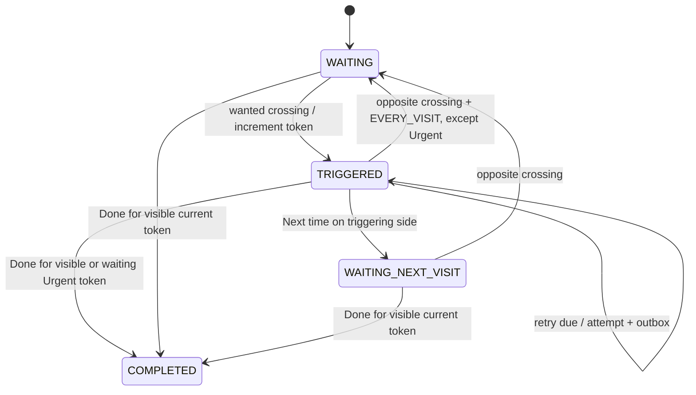

# Reminder lifecycle and action semantics

[Knowledge-base index](Ariciu.md) · [Repository docs](https://github.com/andreicosmin02/Ariciu/blob/master/docs/README.md) · [Developer setup](https://github.com/andreicosmin02/Ariciu/blob/master/README.md#development)

Related: [[Ariciu - Data and Migrations]], [[Ariciu - Notifications and Alarm]], [[Ariciu - Chain Reminders]].

Source: [feature/delivery/model/ReminderLifecycle.kt](https://github.com/andreicosmin02/Ariciu/blob/master/app/src/main/java/ro/andrei/ariciu/feature/delivery/model/ReminderLifecycle.kt) and [DeliveryEngine.kt](https://github.com/andreicosmin02/Ariciu/blob/master/app/src/main/java/ro/andrei/ariciu/feature/delivery/model/DeliveryEngine.kt) under the main package. Status presentation is separate in [feature/reminders/ui/ReminderPresentation.kt](https://github.com/andreicosmin02/Ariciu/blob/master/app/src/main/java/ro/andrei/ariciu/feature/reminders/ui/ReminderPresentation.kt).

## Three independent axes

1. DeliveryPhase: WAITING, TRIGGERED, WAITING_NEXT_VISIT, COMPLETED.
2. Last known AreaPosition: UNKNOWN, INSIDE, OUTSIDE.
3. RegistrationState: PENDING, REGISTERED, BLOCKED, FAILED, PARTIAL, LIMIT_REACHED, INACTIVE.

Notification visibility/outbox and snooze are additional fields, not phases. In particular, a non-Urgent EVERY_VISIT reminder can be WAITING while an older unanswered notification remains visible. Urgent stays TRIGGERED until explicit Done/Next time; hidden retry deadline/attempt are additional fields. The UI's Active tab means phase != COMPLETED, not necessarily successfully registered.

This diagram summarizes phases; guards, visibility and quiet/snooze fields also matter. Do not implement logic by diagram alone.

## Crossings

ENTER sets INSIDE; EXIT sets OUTSIDE. An accepted wanted crossing in WAITING increments occurrence, marks visible/pending, clears quiet and cancels any stored snooze deadline. An opposite crossing rearms WAITING from WAITING_NEXT_VISIT, or from TRIGGERED with EVERY_VISIT for non-Urgent only. An unresolved Urgent updates position/order without rearming or creating a new occurrence. ONCE stays triggered across later visits until handled.

On the same boot, elapsed time <= the last accepted timestamp is rejected. Same-position duplicates are rejected without advancing the timestamp. A different boot allows smaller elapsed time. Completed reminders ignore crossings. The plain engine permits an initial wanted EXIT from UNKNOWN; it does not impose an initial observed ENTER requirement. The platform registration itself requests no initial triggers.

Example ENTER: enter → alert; stay → no duplicate; non-Urgent Every visit leave → rearm; return → new token. Urgent requires explicit handling before a later qualifying visit can create a new occurrence. Example EXIT: depart → alert; to repeat, return then depart again.

## Actions

Notification actions require an active reminder and matching occurrence token; explicit Urgent Done/Next time also work during its hidden retry wait. DISMISS requires current visibility and matching alert attempt; the engine first also matches the parent request ID/generation.

- DONE: COMPLETED, hides notification, clears pending, snooze and Urgent retry deadline.
- NEXT_TIME: hides notification/clears pending, snooze and Urgent retry deadline. While on the triggering side or UNKNOWN, waits for the opposite crossing; if already on the other side it returns to WAITING immediately.
- DISMISS: Urgent-only; hides the alert and persists now + 300000ms. Duplicate/old-attempt dismissal cannot extend/replace its wait. Due wake advances notificationAttempt, not occurrence.
- STOP: quiet=true and pending=true so the existing occurrence is republished quietly; a duplicate Stop is unchanged.
- SNOOZE: hides notification and stores now + 600,000ms. It does not itself complete/rearm the reminder.

STOP/SNOOZE are accepted by DeliveryEngine only for Alarm intensity. Urgent swipe uses DISMISS; other intensities retain NEXT_TIME. Normal has no timed Snooze action.

When due, `onSnoozeDue` clears the deadline, increments occurrence, clears quiet and marks visible/pending. It preserves the current phase/position. The new token prevents an older button from acting on the renewed alert. Wall-clock changes and delayed workers are relevant to diagnosis.

## Editing, restoration and uncertainty

Editing preserves completion/occurrence and replaces the generation. An already-inside registration/re-registration does not invent an arrival. Missing crossings during restrictions cannot be reconstructed. Recovery may therefore conservatively require another opposite crossing rather than create duplicate reminders.

Automatically tested: duplicate/old events, new boot epoch, Once/Every visit/EXIT cycles, stale actions, Stop/Snooze token behavior and persistence models. Physical boundary detection, timing, clock changes and process-kill/reboot delivery are not established by these tests.

## Historical first phone review (rc2)

Card Done also works before a crossing and while snoozed. `DeliveryState.completed()` clears visible/pending/snooze state. Notification Done keeps its visible-token guard; card completion is a distinct explicit task intent. See [[Ariciu - Phone Review 1]].

## Historical second phone review — rc3

Optional immediate arrival is only the first new single ENTER occurrence. After save, fresh/accurate foreground evidence and exact generation pass through the real engine transaction/outbox. Duplicate attempt/reconcile cannot trigger another occurrence; Next time/Every visit require a real opposite crossing. Existing card completion/generation guards remain. No schema change or initialTrigger policy change. See [[Ariciu - Phone Review 2]].

Current delayed-work/recovery/generation details and tests: [[Ariciu - Urgent Re-alerts]].

## Related reading

[Data and Migrations](Ariciu%20-%20Data%20and%20Migrations.md) · [Notifications and Alarm](Ariciu%20-%20Notifications%20and%20Alarm.md) · [Chain Reminders](Ariciu%20-%20Chain%20Reminders.md) · [Phone Review 1](Ariciu%20-%20Phone%20Review%201.md) · [Phone Review 2](Ariciu%20-%20Phone%20Review%202.md) · [Urgent Re-alerts](Ariciu%20-%20Urgent%20Re-alerts.md)
